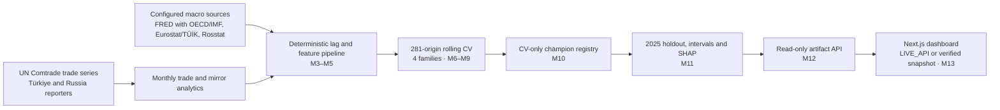

# Bilateral Trade Forecasting & Mirror Statistics Platform

**TR ↔ RU | 14 monthly trade series | 1, 3 and 6-month horizons | 42 forecasting tasks**

**Live dashboard:** [Open the production deployment](https://frontend-ten-psi-12.vercel.app)

This research platform compares four forecasting families for Türkiye–Russia bilateral trade, preserves exporter/importer mirror discrepancies, and serves frozen evaluation results through a read-only API and a five-module dashboard. The headline holdout is a **retrospective latest-vintage evaluation under deterministic lag rules**; it is not an archival real-time replay.

## Results at a glance

| Stage | Verified result |
| --- | --- |
| Development CV (M6–M9) | 42 tasks × 4 families = 168 candidates; shared expanding calendar of 281 monthly origins (96/94/91 for h1/h3/h6), yielding 15,736 observed CV rows. |
| Champion selection (M10) | 33 SARIMA (78.6%) and 9 XGBoost (21.4%). A simpler candidate is preferred when its relative sMAPE loss is strictly below 2%; this selected SARIMA by parsimony for `TR_RU:85` h1/h3 and `TR_RU:TOTAL` h3. Mean/median task-level CV skill versus Seasonal Naive: 30.51% / 28.30%. |
| Eligibility | Negative CV predictions invalidate that family/task candidate; values are retained for audit and never silently clipped. SARIMAX was ineligible on 15 tasks with 27 negative forecasts; XGBoost was ineligible on `RU_TR:74/h1` with one negative forecast. |
| 2025 holdout (M11) | 42 tasks × 12 targets = 504 task/origin cells and 1,512 champion/fallback/baseline role predictions. Operational champion mean sMAPE is 26.17% versus 37.50% for Seasonal Naive (about 30.2% lower relative error). One champion origin used its governed fallback; primary champion metrics and operational metrics remain separately reported. |
| Intervals and explanations | SARIMA uses native 80%/95% intervals; XGBoost uses prequential conformal intervals with eligible residuals only (`target_month <= origin`, minimum observed pool 86). Nominal 80% coverage for the nine XGBoost champion tasks is 67.59% across 108 valid origins. M11 stores 9,072 local SHAP rows. TreeSHAP provides local and global predictive attributions, not causal effects. |
| Serving and UI (M12–M13) | Read-only checksum-verified FastAPI artifact API and a strict-TypeScript Next.js dashboard with `LIVE_API` and verified-snapshot modes. The current suite has 516 passing pytest tests with zero warnings/errors; 102 processed artifacts are SHA-256 protected. The dashboard snapshot SHA-256 is `867a3d8230ca62c23a2f7bc4e7021e0f9f8eba0fe8a727469f1c11b07bebf574`. |



## Findings and method

| Horizon | SARIMA champions | XGBoost champions |
| --- | ---: | ---: |
| h1 | 11 | 3 |
| h3 | 13 | 1 |
| h6 | 9 | 5 |

SARIMA wins most tasks in this frozen comparison. XGBoost wins five of its nine tasks at h6 (`RU_TR:10`, `RU_TR:74`, `TR_RU:73`, `TR_RU:85`, `TR_RU:TOTAL`). This is a descriptive result for the specified series, features, origins and parameters; it does not isolate a macro-variable effect or establish that a family will generalize similarly elsewhere.

The selection and evaluation pipeline applies four explicit controls: (1) candidate eligibility requires nonnegative point forecasts, without clipping; (2) the strict `<2%` relative-sMAPE rule prefers a simpler eligible family; (3) an invalid refit forecast is replaced operationally only by the registered fallback, while raw champion output and fallback use remain visible; and (4) SHA-256 checks tie 102 processed files to the recorded artifact ledger. The 2025 holdout preserves frozen champion assignments and reports raw, primary and operational outcomes separately.

Mirror analytics compare paired Türkiye- and Russia-reported flows distributed through UN Comtrade. They describe reporter/partner discrepancies, missing pairs and valuation differences. The available bundle does not provide separately acquired and independently verified TurkStat and Rosstat datasets. CIF/FOB differences are not a freight-only estimate, and post-2022 paired structural comparisons are unavailable where there are no paired observations.

**Scope:** M11 is a retrospective latest-vintage holdout evaluation under deterministic publication-lag rules. It uses local processed datasets and configured deterministic origin cutoffs; historical `published_at`/`available_at` archives and macro vintage snapshots were not used. Therefore it does not establish real-time decision-time availability or archival-vintage performance. SHAP values explain model predictions and are not causal estimates. This limitation is carried into the API and dashboard.

## Dashboard and API

The dashboard provides five modules: KPI and provenance header; trade/holdout explorer; champion matrix and model diagnostics; SHAP explainability inspector; and mirror discrepancy monitor. It reads either the live read-only API or a deterministic, SHA-256-verified snapshot bundled at `frontend/public/data/`.

| Endpoint | Purpose |
| --- | --- |
| `/health`, `/api/v1/health` | Service liveness and artifact readiness/provenance |
| `/api/v1/sectors` | Frozen series catalog |
| `/api/v1/leaderboard` | CV candidates and task comparisons |
| `/api/v1/forecasts/{sector_id}` | Historical holdout predictions, intervals and fallback diagnostics |
| `/api/v1/explainability/{sector_id}` | Global and local XGBoost TreeSHAP results |
| `/api/v1/mirror-analytics` | Paired mirror observations and discrepancy diagnostics |

Additional read-only routes cover trade history, indicators, overview, metrics and methodology. The API serves frozen artifacts, not newly trained or current-market forecasts. A clean source clone needs the authorized local data bundle; the static frontend build does not require a live Python backend.

## Reproduce locally

Requirements: Python 3.11+ and Node.js 20+.

```bash
uv sync --locked --extra dev
.venv/bin/ruff check .
.venv/bin/pytest -W error
make m10-select
make m11-holdout
make m13-export-snapshot
npm --prefix frontend ci
npm --prefix frontend run build
npm --prefix frontend exec -- tsc --noEmit
```

M10 and M11 outputs are immutable by default. Use fresh output directories for independent reruns, for example `make m10-select M10_OUTPUT_DIR=/tmp/m10-reproduction` and `make m11-holdout M11_OUTPUT_DIR=/tmp/m11-reproduction`. M11 reproduction requires the locally available processed artifacts and uses the documented retrospective scope.

Run the services in separate terminals:

```bash
.venv/bin/uvicorn api.main:app --reload
npm --prefix frontend run dev
```

For Vercel, select `frontend/` as the Root Directory and use its detected Next.js build (`npm run build`). The committed verified snapshot is included as a static asset; no Python backend is needed during build. A live API connection is optional and configured with `NEXT_PUBLIC_API_BASE_URL`.

## Reports and specifications

| Milestone | Evidence |
| --- | --- |
| Pre-M3 | [Full-history verification](docs/PRE_M3_FULL_HISTORY_VERIFICATION_REPORT.md) |
| M3 | [Sector selection](docs/M3_SECTOR_SELECTION_REPORT.md) |
| M4 | [Macro data foundation](docs/M4_MACRO_DATA_FOUNDATION_REPORT.md) |
| M5 | [Feature engineering](docs/M5_FEATURE_ENGINEERING_REPORT.md) |
| M6 | [Seasonal Naive](docs/M6_SEASONAL_NAIVE_REPORT.md) |
| M7 | [SARIMA](docs/M7_SARIMA_REPORT.md) |
| M8 | [SARIMAX](docs/M8_SARIMAX_REPORT.md) |
| M9 | [XGBoost](docs/M9_XGBOOST_REPORT.md), [acceptance](docs/M9_ACCEPTANCE_REPORT.md) |
| M10 | [Champion selection](docs/M10_CHAMPION_SELECTION_REPORT.md), [acceptance](docs/M10_ACCEPTANCE_REPORT.md) |
| M11 | [Final holdout](docs/M11_FINAL_HOLDOUT_REPORT.md), [acceptance](docs/M11_ACCEPTANCE_REPORT.md) |
| M12 | [Serving API](docs/M12_SERVING_API_REPORT.md), [acceptance](docs/M12_ACCEPTANCE_REPORT.md) |
| M13 | [Dashboard](docs/M13_DASHBOARD_FRONTEND_REPORT.md), [acceptance](docs/M13_ACCEPTANCE_REPORT.md) |
| M14 | [Portfolio documentation acceptance](docs/M14_PORTFOLIO_ACCEPTANCE_REPORT.md) |

The [M14 research package](docs/research/README.md) contains the English technical working paper, Turkish summary, Russian abstract, data dictionary, source/licensing register, reproduction guide, portfolio card and generated task-level holdout table. The source-rights review identifies an unresolved FRED software/ML-use question; M14 acceptance remains open pending that review and demo media. The [specification index](specification/00_SPEC_INDEX.md) links the frozen project, data, experiment and milestone contracts. See the [completion and portfolio plan](docs/COMPLETION_AND_PORTFOLIO_PLAN_2026-10-07.md) for remaining M14/M15 work. M10–M13 acceptance does not imply historical vintage archives or a live inference service.
